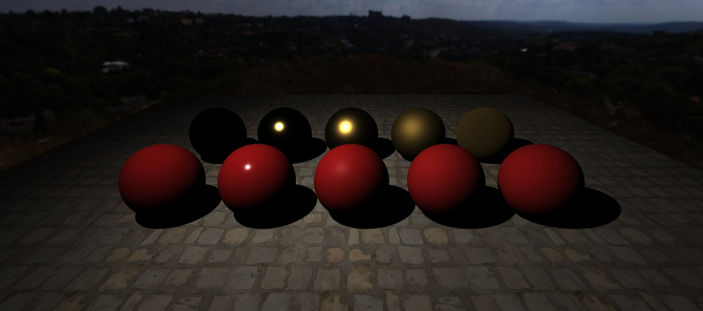

# ComputerGraphicsDX12

DX11로 배운 그래픽스를 DX12로 옮기며 만든 작은 학습용 렌더러다. Hello Triangle부터 시작해 기능을 하나씩 더했고, 마지막 장면은 구 격자에 직접광 PBR과 스포트라이트 그림자를 그린다.



- 포트폴리오: [docs/portfolio/portfolio.pdf](docs/portfolio/portfolio.pdf). 학습 순서(10단계), 고른 안과 버린 안, AI 분담을 A4 9쪽에 정리했다.
- 개발 기록: [DEVELOPMENT.md](DEVELOPMENT.md). 단계별 결정, 작업 규칙, 설계 메모를 에이전트와 공유하려고 적은 문서다.

## 구현한 것

- 프레임 2개 동시 진행. 프레임별 명령 할당자, 펜스 값, 상수 버퍼를 두고, 상수는 256바이트 단위로 선형 할당한다.
- 루트 시그니처 하나. 드로우별 b0과 프레임별 b1은 루트 CBV, 텍스처 t0~t3은 디스크립터 테이블, 샘플러는 정적 샘플러다.
- 깊이 버퍼, 텍스처 업로드(DirectXTex로 읽음), 하늘 큐브맵 패스. PSO는 패스별로 둔다.
- Dear ImGui 조작부와 1인칭 카메라(yaw, pitch로 저장하고 쿼터니언으로 회전).
- Cook-Torrance 직접광 PBR(Schlick Fresnel, GGX, Smith Schlick-GGX)과 항별 디버그 뷰 8개.
- 스포트라이트 그림자 맵(한 자원에 DSV와 SRV, 패스 사이 배리어)과 고정 3×3 PCF.

## 하지 않은 것

창 크기 변경(1920×1080 고정), 감마 보정·HDR·톤 매핑, IBL, 밉맵, 노멀 매핑, 모델 파일 로딩. 정점·인덱스 버퍼는 아직 UPLOAD 힙에 있다.

## 빌드와 실행

Visual Studio 18, MSVC v145, Windows SDK, 부트스트랩한 vcpkg가 필요하다. vcpkg는 `VCPKG_ROOT` 환경 변수나 이 프로젝트 옆 폴더(`..\vcpkg`)에서 찾고, 첫 빌드 때 `vcpkg.json` 의 라이브러리(DirectXTex, Dear ImGui)를 설치한다. 프로젝트 루트의 Developer PowerShell에서 실행한다.

```powershell
MSBuild.exe .\ComputerGraphicsDX12.sln /p:Configuration=Debug /p:Platform=x64 /m /v:minimal
.\x64\Debug\ComputerGraphicsDX12.exe
```

Release는 두 명령의 `Debug` 를 `Release` 로 바꾼다. Debug 빌드는 D3D12 디버그 레이어를 켠다.

## 조작

- 마우스 오른쪽 버튼을 누른 채 움직이면 둘러본다.
- W/S 앞뒤, A/D 좌우, E/Q 위아래로 이동한다.
- ImGui 창에서 광원 위치와 디버그 뷰를 바꾼다.

## 출처와 AI 사용

- 텍스처는 Poly Haven의 CC0 자산이다. 자세한 출처는 [assets/README.md](assets/README.md)에 있다.
- 중간 단계의 레이 씬(`ray-scene` 태그)은 modern_shinobi의 Shadertoy [fsGcW3](https://www.shadertoy.com/view/fsGcW3) 장면을 홍정모 그래픽스 강의 예제를 거쳐 옮긴 것이다. 최종 버전에는 없다.
- 코딩 에이전트(Claude Code, Codex)와 함께 만들었다. 주요 설계 판단과 11/17 이후의 핵심 로직(BRDF 식, 그림자 패스의 판단 자리, PCF)은 내가, 나머지 구현과 통합은 에이전트가 맡았다. 자세한 분담은 포트폴리오 9쪽에 있다.
